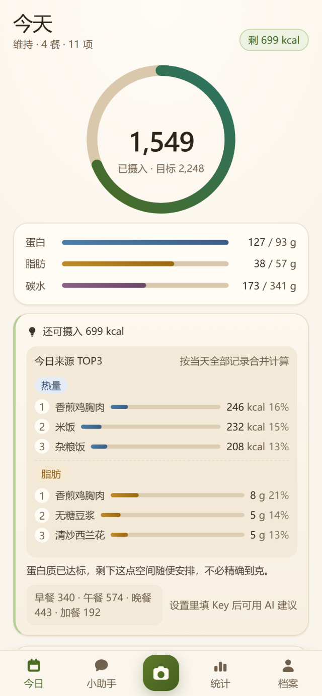
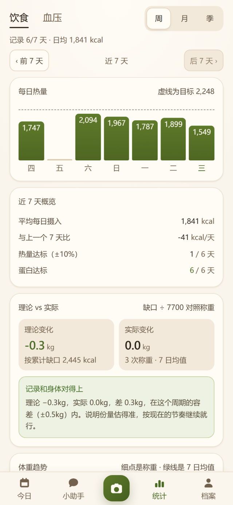
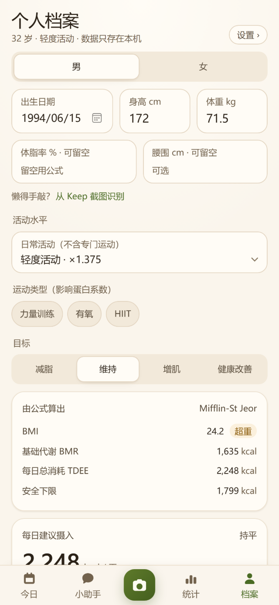

# 好好吃饭 · FoodGuide

拍一张照片，就知道这一餐大概吃了什么。

AI 识别食物与份量，换算成 19 项营养素，对照你自己的每日目标看日 / 周 / 月 / 季。

**v0.9.7** · Android · 纯本地存储 · 无后端

[](https://github.com/nomadz113/foodguide/releases)

| 今日 | 统计 | 个人档案 |
|:---:|:---:|:---:|
|  |  |  |

<sub>截图来自真实运行的界面（`app/tools/shoot-promo.mjs` 跑出来的），内容为示例数据。</sub>

---

## 记录饮食最难的不是吃，是记

大多数饮食 App 的死法都一样：让你搜食物、选克数、点保存，连续记三天，第四天就放弃了。

这个项目只围绕一件事设计：**把一次记录的成本压到「拍一张照」**。

三条不妥协的原则：

- **拍完就算记完** —— 不用搜、不用选、不用称重，AI 给份量，你只需要确认
- **数字由代码算，模型只负责认** —— 热量、克数、达标率全部是可复现的计算，模型编的数字整条丢弃
- **数据不上传** —— 没有账号、没有服务器、没有云端数据库，全部躺在手机本地

## 功能

### 一餐：拍下来就算记完了

- **拍照识别**：拍餐盘，识别食物种类与份量，自动拆出烹饪用油和糖
- **称和血压计也能拍**：体重秤读数、血压计读数拍照即录入，省掉手动填数字
- **自然语言记录**：直接说「中午吃了碗牛肉面」，走意图解析 → 实体解析 → 确认写入三步
- **识别结果进待确认区**：AI 写库必须过一次人工点击，确认后才落库，改起来也方便

### 看懂：目标、达标率、趋势

- **19 项营养素**：热量、蛋白质、脂肪、碳水、膳食纤维、糖、钠、钾、钙、铁、锌、维 A / C / D / E / B1 / B2 / 烟酸 / 叶酸
- **个性化目标**：按 BMR（Mifflin-St Jeor，有体脂率时用 Katch-McArdle）加活动量推导，带热量下限保护
- **多周期统计**：日 / 周 / 月 / 季，达标率按「有记录的天」算，不会因为漏记一天就把平均值拉垮
- **今日页来源 TOP3**：一眼看出今天的热量、蛋白质、脂肪主要来自哪几样东西
- **体重趋势**：原始数据点加 7 日均线，理论体重按累计热量缺口折算
- **血压**：按分级统计，标出晨峰与晚峰，配趋势图

### 助手：说人话，不编数

- **AI 建议**：模型只负责组织语言，所有数字由代码预先算好；输出里一旦出现未经授权的数字，整条建议作废
- **食物库会自己长大**：AI 认得出但库里没有的名字会进「缺口清单」，你可以加个别名、正式入册，或者直接忽略——但必须你点一次，不自动入库

## 下载安装

最新版在 [Releases](https://github.com/nomadz113/foodguide/releases) 页面，两个包选一个：

| 安装包 | 说明 | 体积 |
|---|---|---|
| [wb 版](https://github.com/nomadz113/foodguide/releases/download/v0.9.7/haohao-chifan-0.9.7-wb.apk) | 加载线上托管的页面，拍照识别直接用，需要联网 | 约 5.0 MB |
| [offline 版](https://github.com/nomadz113/foodguide/releases/download/v0.9.7/haohao-chifan-0.9.7-offline.apk) | 页面资源内嵌，断网也能看数据；AI 识别要在「设置」里自备一把百炼密钥 | 约 5.0 MB |

安装步骤：

1. 下载对应的 APK
2. 手机上允许「安装未知来源应用」
3. **覆盖安装即可**，已有记录不会丢——两个包签名相同，可以互相覆盖

也可以不装 APK：用手机浏览器打开托管地址，走「添加到主屏幕」当 PWA 用。

## 隐私

这个项目没有后端，这句话是字面意思：

| 项目 | 实际情况 |
|---|---|
| 账号体系 | 没有 |
| 服务器 | 没有 |
| 云端数据库 | 没有 |
| 数据存放 | 手机里的 IndexedDB，卸载 App 才消失 |
| 唯一联网的地方 | 拍照识别那一步，图片直接发给模型服务商 |
| API 密钥 | 只做混淆后存在本地，不经过任何中间服务器（够不够安全？诚实地说：不够，见下方设计取舍） |
| 备份 | 手动导出 JSON，自己保管 |

代价也很实在：**换手机要自己导出再导入**，因为没有任何云端替你保存。

## 技术栈

| 层 | 选型 |
|---|---|
| 前端 | React 19.3 + TypeScript 7 + Vite 8 |
| 路由 | React Router 7（HashRouter，适配离线 WebView） |
| 存储 | IndexedDB（Dexie 4，九张表） |
| 模型 | 阿里云百炼 `qwen3-vl-plus`（视觉识别）+ `qwen-plus`（文本） |
| 原生壳 | Capacitor 7（Android） |
| 样式 | 手写 CSS 变量，不依赖 Tailwind |
| 测试 | Vitest 5 |

## 仓库结构

```
docs/screenshots/    产品截图（README 里那三张）
app/                 应用主体：源码、安卓工程、构建脚本
  src/core/          业务内核（不依赖 React）
    ai/              唯一网络出口，模型调用与结果守卫
    db/              Dexie 表结构与 DAO
    nutrition/       营养素计算、目标推导
    portion/         份量估算
    intent/          自然语言 → 意图
    report/          周期统计
    bp/  scale/      血压与体重
  src/pages/         路由页面
  android/           Capacitor Android 工程
  tools/             构建、检查与截图脚本
  README.md          更详细的技术文档
```

根目录只有四样：`.gitignore`、`README.md`、`app/`、`docs/`。

**刻意不入库的东西**：API 密钥、APK 签名证书、内部设计文档、换机迁移脚本、本地工具链（JDK + Android SDK）。它们只存在于开发机本地和离线备份里，因为这个仓库是公开的。

## 本地开发

```bash
cd app
npm install
npm run dev
```

识别功能需要一把百炼 API Key，可以写在 `.env.local`，也可以在 App 的「设置」页填（只做混淆后存进 IndexedDB，同下方设计取舍）：

```
DASHSCOPE_API_KEY=sk-你的密钥
DASHSCOPE_BASE_URL=https://dashscope.aliyuncs.com/compatible-mode/v1
VISION_MODEL=qwen3-vl-plus
```

其他命令：

```bash
npm run build      # tsc --noEmit && vite build
npm run typecheck  # 只做类型检查
npm test           # vitest
```

## 打包 Android

```bash
cd app
npm run build
node tools/apk-config.mjs offline     # 或 wb
npx cap copy android
cd android && ./gradlew assembleDebug
```

`tools/apk-config.mjs` 负责在「离线内嵌 dist」和「加载线上页面」两种模式间切换，顺序不能颠倒——直接 `cap sync` 会覆盖掉这份配置。安装包不入库，走 Releases。

## 设计取舍

这些是刻意做的选择，不是没做完：

- **快照式存储**：每条餐食记录自带当时的营养数值，以后改食物库不会篡改历史
- **数字由代码算，模型只叙述**：宁可少说，不让模型编热量和克数
- **`null` 表示未知，不等于 0**：缺失数据不进达标率的分母，覆盖率太低时界面直接显示「—」
- **AI 写库必须一次人工点击**：识别结果先进待确认区，人确认了才落库
- **不做生熟折算**：明知会低估，也如实保留，并在界面标注数据来源
- **密钥只做混淆，不假装加密**：纯前端没有任何能安全保存密钥的地方——密钥要能被浏览器用，就必须能被浏览器读出来。XOR + Base64 只是防止「打开 DevTools 一眼看到 `sk-xxx`」，不防有心人。真要安全只有云函数代理一条路

## 已知限制

- 只做了 Android，iOS 没打包过
- 食物库覆盖有限，冷门菜品依赖 AI 估算，误差会比标准食物大
- 不做生熟换算，米饭这类主食按熟重记，生重口径会偏
- 没有多设备同步，数据只在那一台手机上

## 许可

个人项目，未附开源许可。如需复用请先联系作者。
